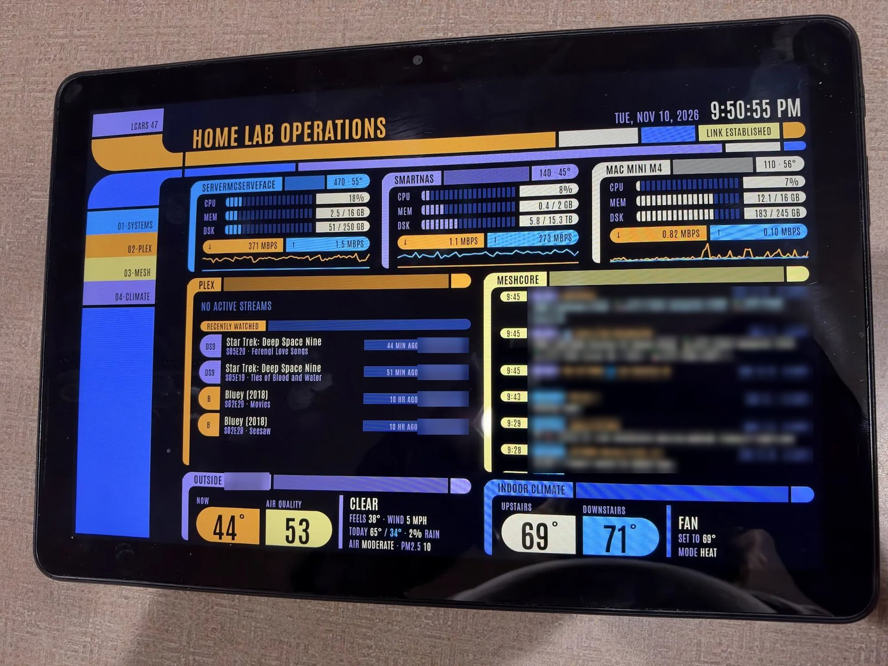
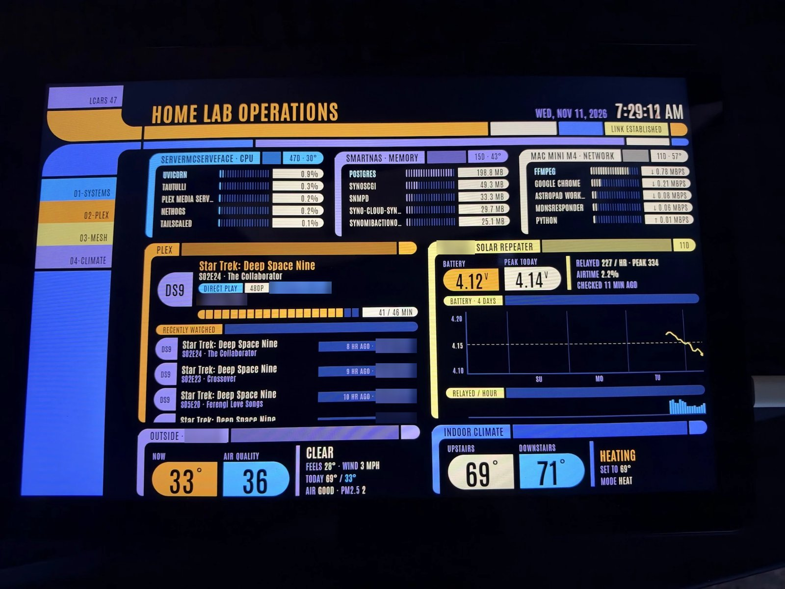

# Yet Another LCARS Dashboard

*Because the galaxy clearly needed one more.*

A home lab status board styled after the LCARS computer screens from *Star Trek*. It runs on an old tablet on the wall and refreshes every few seconds.





*(Usernames and places are blurred in the photos.)*

## What it's built for

This one is wired to **my** setup. Out of the box it supports:

| Panel | Source | What you get |
|---|---|---|
| **Linux server** | Read directly: the backend runs on this machine, in Docker | CPU, memory, disk, network graph, uptime, CPU temp. Tap for top apps by CPU, memory and network (network per app via `nethogs`). |
| **Synology NAS** | SNMP v2c (read-only) | CPU, memory, volume, network, uptime, temp. Tap for top processes and connections per service. |
| **Mac** | A small helper in `mac-helper/` running on the Mac | Same meters, plus CPU temp via [`macmon`](https://github.com/vladkens/macmon) and per-app network via `nettop`. |
| **Plex** | [Tautulli](https://tautulli.com/) API | Who's watching what, with progress, plus a scrollable "recently watched" list. |
| **MeshCore** | [RemoteTerm](https://github.com/jkingsman/Remote-Terminal-for-MeshCore) API | Latest mesh messages. Tap to switch to the repeater panel. |
| **Solar repeater** | MeshCore repeater status, requested over the mesh through RemoteTerm | Battery voltage over 4 days, packets relayed per hour, airtime. |
| **Outside** | [Open-Meteo](https://open-meteo.com/) (free, no key) | Temperature, feels-like, wind, today's high and low, air quality. |
| **Hot tub** | Home Assistant, via the [ha-bestway](https://github.com/cdpuk/ha-bestway) add-on (Bestway / Lay-Z-Spa / SaluSpa) | Water vs target temperature, power / heater / filter lights, error codes, and a 24-hour chart of water temperature with heater-on time. Shares the Outside spot: it flips every 20 s, or tap. |
| **Indoor climate** | Home Assistant REST API (an ecobee in my case) | Room temperatures, thermostat setpoint and mode. |
| **Tesla** | [TeslaMate](https://github.com/teslamate-org/teslamate): its MQTT feed for live status, its database (read-only) for history | Parked / driving / charging / asleep, battery % and range, charge bar, live charging power, energy added and time to full (or the last charge), 24-hour battery chart. Shares the Plex spot: it flips every 20 s, or tap. |

**Full-screen views:** tap any panel's title bar for a bigger view with longer graphs. BACK, or 60 seconds untouched, goes back to the overview.

| Panel | Full-screen view |
|---|---|
| Server / NAS / Mac | CPU, memory and network graphs over 1 hour, 24 hours or 7 days, all three top-app lists at once, disk growth per day, peak temperature. History is saved as one-minute averages in `data/history.db` (kept 8 days), so the graphs start filling after the update. |
| Plex | Now playing, plays per day for 30 days, top shows, movies and viewers this week, library size, the last 60 plays. |
| MeshCore | The last 24 hours of messages, messages per hour by channel, busiest channels and senders, the local radio's signal and packet counts, nodes heard in the last 7 days. |
| Solar repeater | Battery over 4 or 14 days, each day's low-to-peak range, packets relayed per hour, noise floor. |
| Outside | Temperature and feels-like for the past day and next two (or the coming week), chance of rain, a 7-day forecast, sunrise / sunset / UV, air quality for the past and next 24 hours. |
| Indoor | Each room's temperature with the set point and heating / cooling periods over 24 hours to 7 days, humidity, HVAC hours per day. |
| Hot tub | Water vs target over 24 hours to 7 days with heating and filter runs, heat-up and cool-down rates, time to target, heater hours per day. |
| Tesla | Battery % over 7 or 30 days with charging and driving shaded, distance per day, every drive (from → to, distance, time, Wh per mile/km) and charging session (where, kWh, % before and after, peak kW, cost), weekly and 30-day totals, efficiency, range at 100% compared with new. |

**Hot tub note:** some Bestway pumps (mine is an UltraFit AirJet) report their readings with short names (`Tnow`, `Tset`, `heat`) that ha-bestway 1.11.1 ignores, so the temperature shows as *unknown* in Home Assistant. [`docs/ha-bestway-v1-short-names.patch`](docs/ha-bestway-v1-short-names.patch) is a three-line fix for the add-on. Updating the add-on removes it, so you'd have to apply it again.

Any panel whose settings are blank in `.env` just shows "not configured". You don't need all of them.

## Make it yours (the easy way)

Your home lab is not my home lab. Different gear, different services, different ideas about what belongs on the wall.

**Point Claude at this repo and ask it to change the widgets.** Clone it, open it in [Claude Code](https://claude.com/claude-code), and say what you want. For example:

- "Replace the Synology panel with my Unraid server."
- "Swap Plex for Jellyfin."
- "Add a Pi-hole panel showing queries blocked today."
- "I don't have MeshCore. Put a Home Assistant energy panel in that spot."
- "Make it fit my 1920×1080 monitor instead of a tablet."

The code is small and plain on purpose, so it's easy to change:

- one Python class per data source
- one render function per panel
- no frontend framework or build step

## How it's put together

| File | What it does |
|---|---|
| `app/collectors.py` | One class per data source. Each one runs on its own timer and keeps its latest result. |
| `app/main.py` | FastAPI backend. Runs the collectors and serves `/api/status`, `/api/detail/<panel>` (extra data for full-screen views) and the page. |
| `app/static/` | The page: `index.html`, `lcars.css` (all the LCARS shapes) and `app.js` (polls `/api/status` every 3 s and draws the panels). |
| `app/static/sounds/` | Key-press sounds. One is picked at random on each tap. |
| `mac-helper/` | Small stats server for a Mac, plus a LaunchAgent installer. |
| `.env.example` | Every setting, with comments. Copy it to `.env`. |

The LCARS look is pure CSS. There are no images or icon fonts. It uses:

- flat color blocks on black
- one-sided rounded pills and elbows, made with `border-radius` plus black cut-outs
- the condensed [Antonio](https://fonts.google.com/specimen/Antonio) font

## Setup

On the Linux box that will run it (Docker required):

```bash
git clone https://github.com/F86Pilot/yet-another-lcars-dashboard.git
cd yet-another-lcars-dashboard
cp .env.example .env      # fill in what you have; leave the rest blank
docker compose up -d --build
```

Then open `http://<server-ip>:<PORT>` (whatever you set as `PORT`, for example 8088).

Notes:

- **Docker settings:**
  - `network_mode: host`, so the network graph sees the real network interface.
  - `pid: host` plus the `cap_add` list, so the server panel can show which programs are using CPU, memory and network.

  If you don't want those views, remove the extra permissions. The panel still shows its meters.
- **Updating the page:** after changing `lcars.css` or `app.js`, bump the `?v=` number in `index.html` so browsers pick up the new file.
- **Logs:** `docker compose logs -f`
- **Tesla:** the dashboard needs TeslaMate's MQTT port and a *read-only* Postgres login. If TeslaMate runs on the same machine, publish both on localhost only in TeslaMate's `docker-compose.yml` (`127.0.0.1:1883:1883` on mosquitto, `127.0.0.1:5432:5432` on the database), then create the login:

  ```sql
  CREATE ROLE lcars_ro LOGIN PASSWORD 'pick-one';
  ALTER ROLE lcars_ro SET default_transaction_read_only = on;
  GRANT CONNECT ON DATABASE teslamate TO lcars_ro;
  GRANT USAGE ON SCHEMA public TO lcars_ro;
  GRANT SELECT ON ALL TABLES IN SCHEMA public TO lcars_ro;
  ALTER DEFAULT PRIVILEGES FOR ROLE teslamate IN SCHEMA public GRANT SELECT ON TABLES TO lcars_ro;
  ```

  Distances follow TeslaMate's own unit setting.

### Mac helper (optional)

On the Mac:

```bash
brew install macmon               # optional, for CPU temperature
bash mac-helper/install.sh        # installs and starts at login; re-run after edits
```

Then set `MAC_STATS_URL=http://<mac-ip>:8089` in `.env`.

To remove it:

```bash
launchctl bootout gui/$(id -u)/com.lcars.machelper; rm ~/Library/LaunchAgents/com.lcars.machelper.plist
```

### Wall tablet

Mine is a Fire HD 10 (2023, 1280×800) running [Fully Kiosk Browser](https://www.fully-kiosk.com/), with Amazon's apps disabled over `adb`. The layout locks to one screen at tablet size and scrolls normally on anything smaller.

- **Battery:** a tablet that's always plugged in keeps its battery full and warm, which wears it out and can make it swell. A smart plug that Home Assistant switches on and off by battery level helps.
- **Sound:** the browser won't play the tap sounds until the screen has been touched once after the page loads.

## Security note

There's **no login**. Anyone who can reach the dashboard can see what it shows:

- Plex usernames
- mesh messages
- running programs
- room temperatures
- your car's state and charge, and the places your drives started and ended (Tesla full-screen view)

The Mac helper is also open to anyone on your network. Keep both on your home network, or behind a VPN like Tailscale. Don't expose them to the internet.

## Not affiliated

This is a fan project. *Star Trek* and LCARS belong to their owners, and the original LCARS design is the work of Michael Okuda. Everything here is original and only inspired by that style.

## License

[MIT](LICENSE). Copy it, change it, use it however you like.
